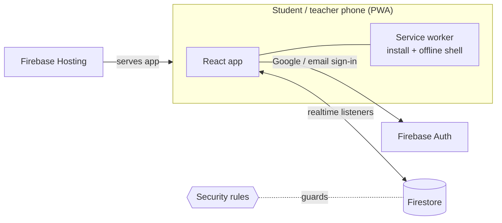

<p align="center">
  
</p>

<h1 align="center">BCNY Board</h1>

<p align="center">
  An installable leaderboard app for the teens I tutor at The Boys' Club of New York.<br/>
  Students check their rank from their home screen; the teacher hands out points and posts announcements. Runs entirely on Firebase's free tier.
</p>

<p align="center">
  
  
  
  
</p>

---

## Why I built it

I tutor in BCNY's Teens & Explorers program, and points are how we keep sessions fun and competitive. Tracking them on paper meant the kids only knew where they stood when I read the list out loud. I wanted something they could open themselves, on their own phones, with no app store involved, and a way for me to reach the whole group without a group chat.

## Features

**Students**
- Pick **Student** or **Teacher** and **Sign in** or **Create account**, with Google or email/password (plus password reset)
- See their rank front and center, the points gap to the person above them, a top-3 podium, and the full board
- Live updates: the board changes the moment points are awarded
- Install to the home screen on iPhone or Android, with guided instructions per platform
- Announcements tab with an unread badge that stays in sync across their devices, plus an in-app alert when something is posted while the app is open

**Teacher**
- **Board:** one-tap −1 / +1 / +5, or custom amounts with a private reason and per-student history
- **Students:** everyone who has signed up, with search; choose who appears on the leaderboard
- **Announce:** post a message to every student's Announcements tab, and delete old ones

## Architecture



There's no custom backend. All business logic runs in the client, and Firestore security rules are the trust boundary, which keeps the whole app on Firebase's free Spark plan.

| Collection | Contents | Who can read | Who can write |
|---|---|---|---|
| `users/{uid}` | name, email, photo, last-read announcement time | that user, teacher | that user (whitelisted fields only) |
| `leaderboard/{uid}` | display name, photo, points | any signed-in user | teacher |
| `pointsLog/{id}` | delta, reason, timestamp | teacher | teacher (append-only) |
| `announcements/{id}` | title, body, author, time | any signed-in user | teacher |
| `teachers/{email}` | marks an account as a teacher | that teacher | nobody (set in console) |

## Engineering notes

A few problems that took more than the obvious solution:

- **Security lives in the rules, not the UI.** Role checks in React only decide which screens to show. Firestore rules enforce everything: students can't change points even with devtools open, profiles accept only whitelisted fields, points must be non-negative integers, and the point log is append-only. Teacher access requires a *verified* email listed in a `teachers` collection that the app itself can't write to, so choosing "Teacher" on the login screen is a request, not a grant.
- **Unread badges without a server.** Each student's profile stores when they last opened Announcements. The badge compares that to post timestamps, so reading on one device clears it everywhere. Server-timestamp estimates keep it correct even before a write is confirmed.
- **Race-free points.** Point changes run in a Firestore transaction that clamps at zero and writes the log entry atomically, so two quick taps never lose an update.
- **Free-tier by design.** Push notifications would require Cloud Functions (paid plan), so announcements live in an in-app feed instead. A conscious tradeoff for a nonprofit program.
- **Works offline.** Firestore's persistent cache plus a network-first app shell mean the board still opens with no signal.

## Project structure

```
src/
  App.jsx            auth state, role routing
  Login.jsx          Google + email/password, sign-up, reset
  StudentHome.jsx    rank hero, podium, board, announcements feed
  TeacherHome.jsx    Board / Students / Announce tabs
  Leaderboard.jsx    shared board + podium, realtime hook
  DeviceCards.jsx    install-to-home-screen prompt
  pwa.js             service worker registration, platform checks
  firebase.js        Firebase init, teacher check
public/sw.js         installability + offline cache
firestore.rules      access control
```

## Run your own

<details>
<summary>Setup steps (about 10 minutes, free)</summary>

1. Create a Firebase project. The free **Spark** plan is all you need.
2. Add a **Web app**. Copy `.env.example` to `.env.local` and fill in the config. Set `VITE_FB_AUTH_DOMAIN` to `<project-id>.web.app` so Google sign-in works inside the installed app.
3. **Authentication:** enable Google and Email/Password.
4. **Firestore:** create a database in production mode.
5. **Make yourself the teacher:** in Firestore, create a collection `teachers` with a document whose ID is your email in lowercase (add any field, e.g. `role: "teacher"`). Then sign in with **Teacher** selected. Google accounts are verified automatically; email/password teachers get a verification link first.
6. Deploy:
   ```bash
   npm install
   npm i -g firebase-tools && firebase login
   firebase use --add
   npm run deploy
   ```

**Good to know**
- Drop the organization's logo at `public/bcny-logo.png` and it appears on the login screen (shown in white on the blue header). Without it, the org name shows as text.
- Removing a student from the board erases their points.
- `npm run dev` runs everything locally against your Firebase project.

</details>

## Roadmap

- Optional push notifications via a free serverless function
- Badges and point categories
- Seasons: weekly or monthly resets with an archive of past winners
- Bulk awards for the whole group after an activity

## Author

**Maximus Bhuiyan**: Columbia 3-2 Pre-Engineering student at CUNY Queens College, tutor at The Boys' Club of New York, and co-founder of Fragmnt NYC.
